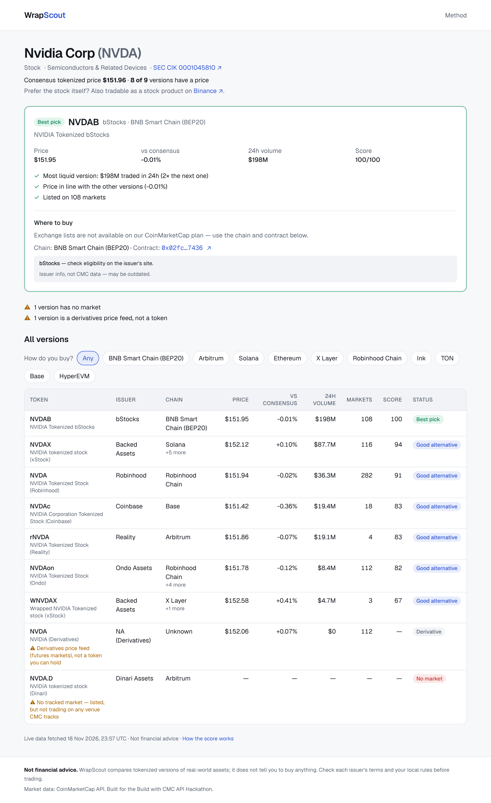

# WrapScout

**Which token should I buy to own Nvidia?**

A stock, an ETF or an ounce of gold now exists in several tokenized versions: xStocks, Ondo, Robinhood,
bStocks, Dinari, Paxos, Tether… on different chains, with very different liquidity. Some have no market at
all, some trade $43 a day, some quote a different unit. WrapScout takes one asset, ranks every tokenized
version of it with a transparent score built on CoinMarketCap data, and answers three questions: **which one,
why, and where to buy it.**

Built for the [Build with CMC: API Hackathon](https://coinmarketcap.com/api/hackathon/) — track **Real World Assets**.

> **Live demo:** _coming soon_ · **Video:** _coming soon_ · **60-second judge guide:** [JUDGE.md](JUDGE.md)


<sub>Screenshot taken in demo mode (synthetic values). The live site uses real CoinMarketCap data.</sub>

## What it does

- **Search** any tokenized stock, ETF, commodity or fund by ticker or name.
- **Best pick** for that asset, with plain-language reasons ("Most liquid version: $4.2M traded in 24h,
  8× the next one", "Price in line with the consensus", "Listed on 12 markets").
- **Where to buy:** exchanges CoinMarketCap tracks for it, its chain, contract address and explorer link, and a
  short note on who the issuer serves (for example, not offered to US persons).
- **Every other version**, with what is wrong with it: *No market*, *Too thin*, *Different unit*, or simply a
  weaker score. A "How do you buy?" filter shows the best version on your chain.
- **Method page** that explains the score, and a **JSON API** (`GET /api/asset/nvda`) returning the same view.
- **MCP server** so an AI assistant can answer "which tokenized Nvidia should I buy?" with the same deterministic
  ranking instead of guessing (see below).

## Use it from Claude, Cursor or any MCP client

```bash
claude mcp add wrapscout -- npx tsx /absolute/path/to/CMC-hack/mcp/server.ts
```

| Tool | What it returns |
|---|---|
| `search_tokenized_assets(query)` | Assets with tokenized versions matching a ticker or name |
| `best_tokenized_version(symbol)` | Best pick, reasons, where to buy, issuer note, what to watch out for |
| `compare_tokenized_versions(symbol)` | Every version with issuer, chain, label, score, price, volume and warnings |

It reads the same data as the site: live CMC with `CMC_API_KEY`, else `data/snapshot/`, else demo data
(clearly labelled in every answer).

## How the score works

1. **Filter out what you should not buy.** No tracked market (`price: null`), a price more than 25% away from
   the reference price (a different unit, such as grams versus ounces), or less than $10k traded in 24h. The
   reference is CMC's consensus tokenized price when it agrees with the market, otherwise the volume-weighted
   median of the versions.
2. **Score the rest from 0 to 100:** liquidity 50% (log of 24h volume), price fidelity 30% (distance from the
   volume-weighted median, zero at 2%), market reach 20% (number of markets, full marks at 5).
3. **Label:** Best pick / Only option, Good alternative (≥ 60), Weak.

The thresholds live in [`src/lib/score/config.ts`](src/lib/score/config.ts) and are rendered on `/method`. The
score is deterministic, uses no AI, and has no opinion about the underlying asset.

## CoinMarketCap endpoints used

| Endpoint | Used for |
|---|---|
| `GET /v5/real-world-assets/map` | Search index: every underlying, its type and `has_tokens` |
| `GET /v5/real-world-assets/assets/list` | Popular assets by tokenized market cap |
| `GET /v5/real-world-assets/quotes/latest` | Consensus tokenized price + every wrapper (`tokens[]`: issuer, price, volume) |
| `GET /v5/real-world-assets/info` | Registrant metadata (industry, SEC CIK) |
| `GET /v2/cryptocurrency/info` | Each wrapper's chain, contract and explorer |
| `GET /v2/cryptocurrency/quotes/latest` | Each wrapper's `num_market_pairs` and 24h volume |
| `GET /v2/cryptocurrency/market-pairs/latest` | Exchanges for the top wrappers, when the plan allows it |
| `GET /v1/key/info` | Credit usage (scripts) |

**Why CoinMarketCap:** the join that makes this product possible is CMC-specific. One RWA quote returns every
wrapper of an asset with its issuer, and each wrapper's `crypto_id` resolves to its chain, its markets and its
volume in the cryptocurrency API. Without CMC you would have to crawl every issuer's catalogue and every venue.

## Run it

```bash
npm install
npm run dev            # http://localhost:3000 — demo mode (synthetic data, clearly labelled) without a key
```

With a CoinMarketCap API key:

```bash
cp .env.example .env.local      # then set CMC_API_KEY
npm run explore -- NVDA TSLA XAU SPY MS   # records raw responses to fixtures/live/ and prints a status table
npm run snapshot                # writes data/snapshot/ (every searchable asset), commit it
npm run dev
```

### Data modes

| Situation | What is served | Banner |
|---|---|---|
| `CMC_API_KEY` set | Live CMC data, cached ~2 min | none |
| Key set but CMC errors or takes > 8 s | `data/snapshot/` | "Live data unavailable, showing snapshot from …" |
| No key, `data/snapshot/` present | `data/snapshot/` | "showing snapshot from …" |
| No key, no snapshot | `fixtures/demo-snapshot/` (synthetic) | "Demo data" |

The snapshot means the site keeps answering even if the key expires or the quota runs out during judging.

### Deploy

Any Node host works (Vercel, Railway…). Set `CMC_API_KEY` and `SITE_URL` (public URL, used for share images),
and commit a fresh `data/snapshot/` before deploying.

## Architecture

```
Browser ──► Next.js 16 (server components + /api routes)
              ├─ src/lib/cmc/client.ts      one GET: key header, 429/5xx backoff, 400/401/403/404/405 classification
              ├─ src/lib/cmc/endpoints.ts   typed endpoints, batching (50 / 100 ids), bad-id retry, throttling
              ├─ src/lib/cache.ts           LRU + TTL + in-flight coalescing (cost scales with time, not visitors)
              ├─ src/lib/data/              live / snapshot / demo sources, 8 s timeout, fallback
              ├─ src/lib/normalize.ts       raw CMC shapes → wrappers (v5 `quotes` array vs v2 `quote` object)
              ├─ src/lib/score/             eligibility, score, labels, reasons — pure functions
              └─ src/lib/search.ts          ticker / name search
```

## Tests

```bash
npm test               # unit tests (Vitest): normalization, scoring, cache, CMC client, data sources, search
npm run build && npm run e2e   # Playwright smoke tests against the production build in demo mode
```

Unit tests run on **synthetic fixtures** in `fixtures/cmc/`, modelled on the API's documented shapes (see
[fixtures/README.md](fixtures/README.md)). `npm run explore` records real responses to check them against.

## Limits

- The consensus price is CMC's average of the tokenized versions, not the stock-exchange price.
- Issuer availability notes ([`data/issuers.json`](data/issuers.json)) are hand-written, may be outdated and
  never affect the score.
- Not financial advice.

## API feedback

See [FEEDBACK.md](FEEDBACK.md).

## License

[MIT](LICENSE)
